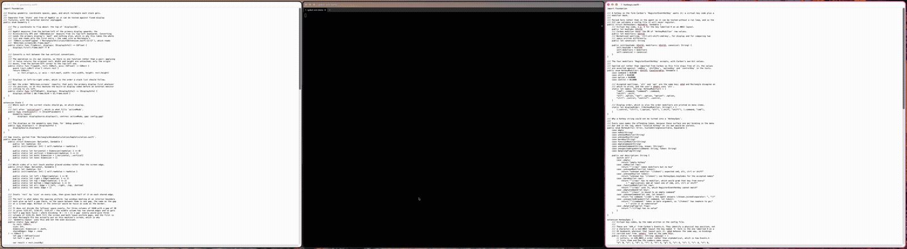
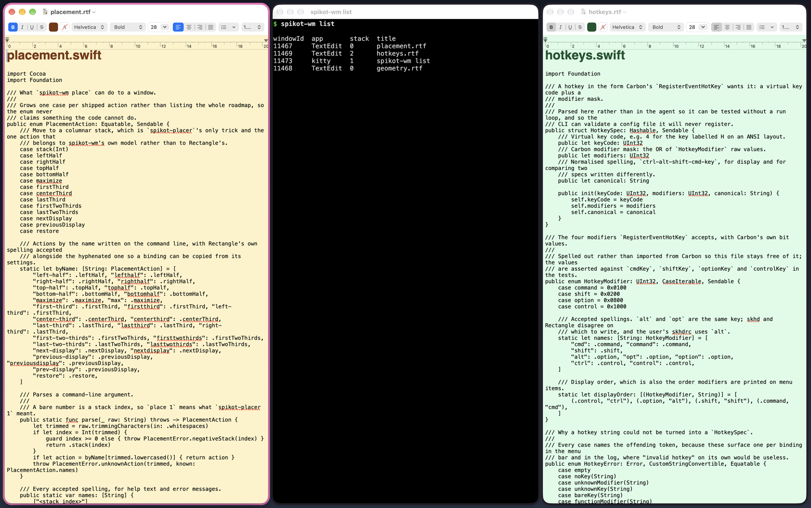
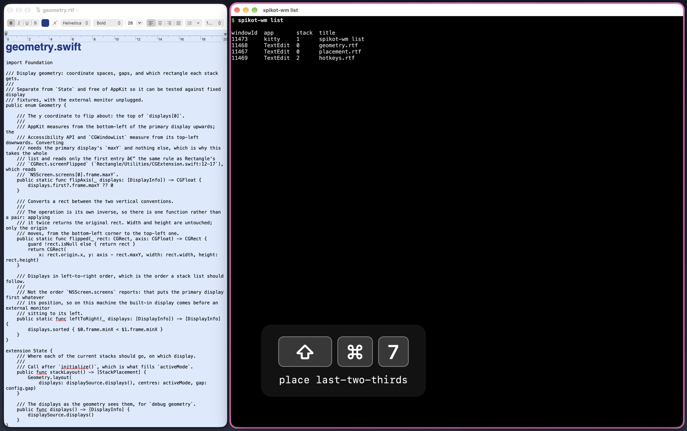
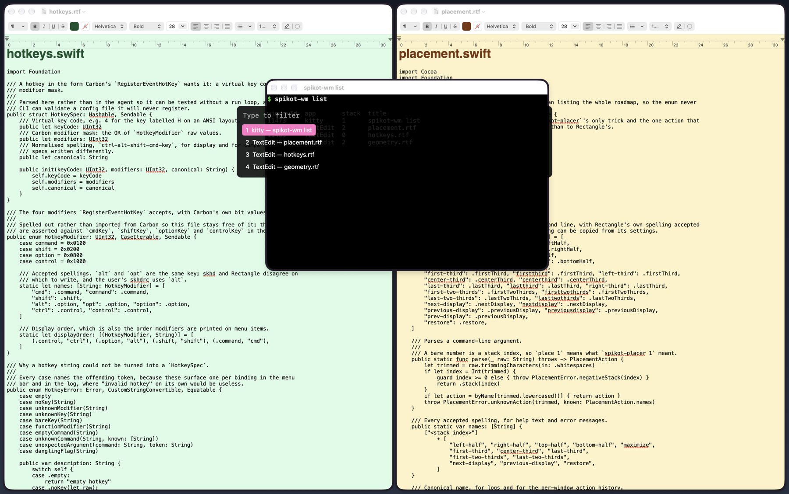

# Demo



The same recording as video: [demo.mp4](demo.mp4) (86 s, 1800x1130).

Each step shows the key the config binds to its command. A step whose command has no binding
shows the `spikot-wm` command line instead. In order:

1. Four windows placed into the three stacks of `threeColumns` (`spikot-wm place 0`, `1`, `2`)
2. Focus between stacks and within one: `alt-l`, `alt-h`, `alt-j`, `alt-k`
3. A third and two thirds filling the width: `cmd-shift-3` with `cmd-shift-7`, then
   `cmd-shift-6` with `cmd-shift-5`
4. Halves, `cmd-shift-1` and `cmd-shift-2`
5. `cmd-alt-f` to maximize, then `spikot-wm place restore`
6. The picker over every window, `alt-v`: arrow keys and return, then typing to filter
7. The picker over one application's windows, which `launch` shows when it has several

| Stacks | A third and two thirds | Picker |
|---|---|---|
|  |  |  |

## Recording it again

```bash
Contrib/demo/record.sh            # writes into docs/
Contrib/demo/record.sh /tmp/out   # or anywhere else
```

It writes `demo.mp4`, `demo.gif`, `stacks.png`, `thirds.png` and `picker.png`, and takes about
100 seconds. The output size follows the main display: these were recorded on a 1800x1169
built-in display, with the menu bar cropped.

Requirements:

- The agent running, with its Accessibility grant
- Screen Recording granted to the terminal the script runs in
- `ffmpeg` and `kitty` on `PATH`, and `spikot-wm`
- TextEdit not running. The script quits TextEdit when it finishes, so it refuses to start
  rather than close documents of yours

The keys shown come from `spikot-wm config`, so a different config shows different keys. The
script stops if a key it presses is unbound.

## What it does to the desktop

While it records:

- Every application except Finder is hidden, until `spikot-wm list` shows no windows.
  Finder stays visible because hiding it makes macOS unhide another application. A Finder
  window left open stops the script
- A dark backdrop covers the desktop icons and widgets, at window level -1 so that it sits
  below every normal window
- The only windows are three TextEdit documents, copies of `Sources/StateCore/geometry.swift`,
  `hotkeys.swift` and `placement.swift` on blue, green and amber pages, and a kitty started
  with `--config NONE` running `Contrib/demo/term.sh`, which redraws `spikot-wm list` every
  second
- A check runs every 0.5 s. If any other window appears, the recording stops and nothing is
  kept

On exit, including after an error or Ctrl-C, it closes TextEdit and the demo kitty, unhides
exactly the applications it hid, and deletes its temporary directory.

## How the steps are driven

Posted key events do not trigger the agent's Carbon hotkeys (see `manual-tests.org`), so the
script runs each bound command itself, through the CLI or the agent's socket, and draws the key
with `Contrib/demo/overlay.swift`.

The pickers need two more things:

- A picker opened from the socket cannot become the key window, and the agent dismisses it after
  0.4 s. The script activates the agent with `open -b org.traf.spikot-wm` first, which lets it.
- Keys typed into the picker are real posted events. Posting needs Accessibility, which the
  terminal may not have, so `Contrib/demo/apps.swift keys` runs through the agent's `exec`,
  whose children have the agent's grant.

## Known issues

- TextEdit underlines identifiers as misspellings. The script tries to turn spell checking off,
  but TextEdit's preferences live in its sandbox container and macOS refuses that write from a
  terminal. Unticking "Check spelling as you type" in TextEdit's settings removes the marks from
  later recordings
- `demo.gif` is 8.2 MB
